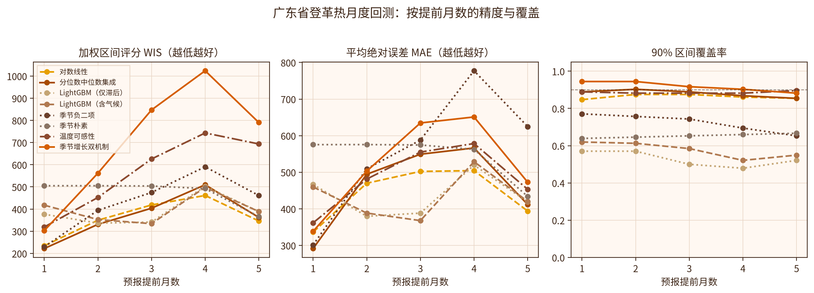
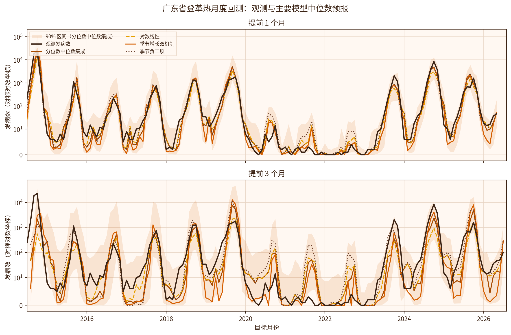
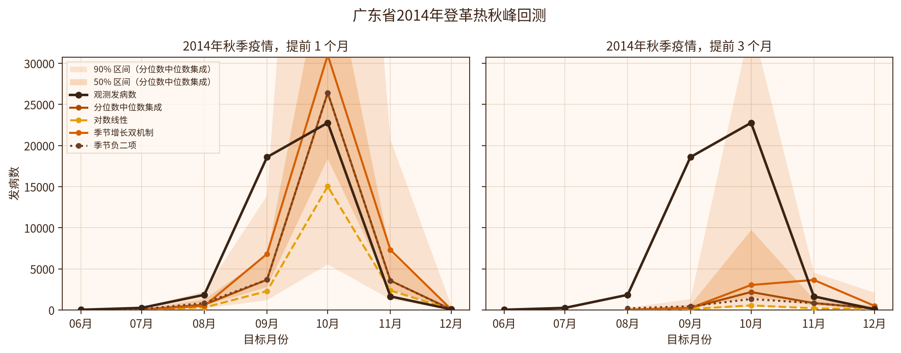
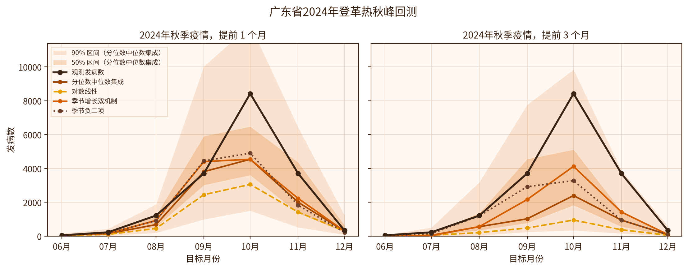
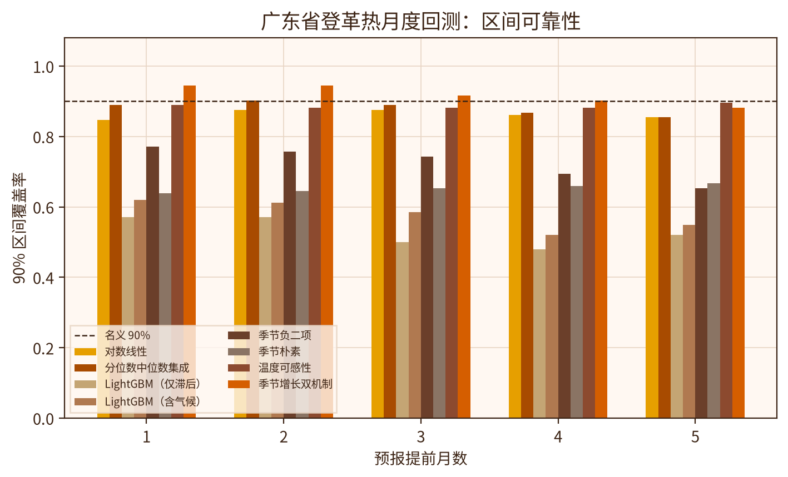

# GZNL-dengue-forecast-models

广州国家实验室（GZNL Group）的中国登革热月度发病数预测模型，面向
[China Infectious Disease Forecast Hub](https://github.com/dailypartita/China-Infectious-Disease-Forecast-Hub)
的目标 **`mo inc dengue cases`**。

方法改编自 EpiETL `modeling` 套件（`backtest.py`、`ensemble_conformal.py`、
`forecast_final.py`、`prepare_data.py`）。原套件在本地全国序列上比较了多种模型；
其 `metrics_summary_v2.csv` 以 **lightgbm_cqr**（LightGBM 分位数回归 + 滑动窗口 CQR，
并带 lag-1 气候协变量）为登革热头牌方案。本仓库提交的就是这一方案，但做了三处
枢纽化改动：病例目标只用枢纽官方月度全国序列，输出改为枢纽要求的 23 个分位数，
并按提交日历把模型步长 1–5 个月对应到 hub horizon −1…3。地点仅为 `CN`，单位是
非负整数病例数。不把 Prophet 或分位数集成放进提交模型。

本目录提交的模型是 **GZNL-DengueLGBMCQR**。`designated_model` 设为 `false`：
GZNL 在该 hub 已有两个指定模型（NextWave、VincentAvg），一队最多指定两个。
模型简称带有 `Dengue` 前缀，避免与其他病种的同名方法冲突。

该模型已注册并提交 2026-11-01 轮预测，见枢纽仓库中的
[`GZNL-DengueLGBMCQR`](https://github.com/dailypartita/China-Infectious-Disease-Forecast-Hub/tree/main/model-output/GZNL-DengueLGBMCQR)。
本仓库当前文件是在同一模型编号下、加入 lag-1 气候特征后重新训练的结果。
广东省序列上的多模型历史比较另见文末「广东省历史回测」。那一节只记录省域回测，没有改写本模型，也没有把该实验重新提交到枢纽。

## 预测目标

| 字段 | 取值 |
|------|------|
| `target` | `mo inc dengue cases` |
| `location` | `CN` |
| 单位 | 全国月度报告病例数，非负整数 |
| 提交步长 | 整数 `−1` 到 `3` 个月 |
| 分位数 | hub 规定的 23 个水平（0.01 … 0.99） |
| `reference_date` | 当月 1 日；`target_end_date = reference_date + horizon 个自然月` |

Hub 登革热的 `reference_date` 是当月 1 日。以 2026-11-01 轮为例，最后一次观测是
**2026-09-01**，因此 hub horizon −1、0、1、2、3 分别对应模型 lead 1 到 5
（目标月 2026-10 至 2027-02）。日期一律用日历月偏移，绝不用周。

## 训练集

病例来自官方 hub 文件 `target-data/time-series.csv`，筛选
`target == "mo inc dengue cases"` 且 `location == "CN"`。本仓库
`data/time-series.csv` 是生成 2026-11-01 提交时使用的快照，也是回测的唯一病例目标。

该快照中，登革热序列一共有 **273 个整月观测**，时间范围是
**2004-01-01 至 2026-09-01**，中间没有缺月，全部为有限非负数值。
历史峰值出现在 2014-10（28,796 例），2024-10 为近年高峰（11,083 例）。
2026 年近期观测：01=93，02=94，03=92，04=137，05=222，06=255，07=1,120，08=836，09=486。
EpiETL 整理的全国合计与这条枢纽序列不一致（例如 2026-08 为 683 对 836），
因此只借用 EpiETL 的气候序列，不借用它的病例数。

气候按月初日期合并到病例序列上，文件是：

| 文件 | 内容 | 覆盖 | 行数 |
|------|------|------|------|
| `data/covariates_enso.csv` | NOAA ONI（`enso_oni`，海温距平，`unit=degC_anom`，`source=noaa_oni`） | 1950-01-01 至 2026-08-01，无缺月 | 920 |
| `data/covariates_era5_china.csv` | ERA5 中国月平均（`geo_name=China`，`iso3=CHN`）：`temp_mean`、`precip_mean`、`rel_humid_mean` | 2010-01-01 至 2026-09-01，无缺月 | 201 |

ERA5 只保留中国，不提交原来的 30 个国家表。数值从 EpiETL 的 parquet 原样写出，CSV 以完整的 float64 精度保存。

在起点月 `t`，四个气候特征 `enso_oni_l1`、`temp_mean_l1`、`precip_mean_l1`、`rel_humid_mean_l1` 取的是 **`t−1` 月**的协变量，也就是做预测时已经发布的值。直接多步预测的每个 lead 都使用起点 `t` 上的同一行特征，因此任何步长都不会读到 `t` 月或更晚的气候。2026-11-01 这轮的预测起点是 2026-09，对应的 lag-1 气候月是 **2026-08**（ONI 收到 2026-08 即够用）。ERA5 中国的 2026-09 已在文件中，本轮预测不使用它。

气候缺测不做插补。病例滞后从 2004-12 起就可以构成完整的病例特征，但 ERA5 中国从 2010-01 才开始，所以 2010-01 及更早的起点缺少完整的 lag-1 气候，训练时随 `dropna` 删掉。第一个完整起点是 **2010-02-01**（使用 2010-01 的 ONI 与 ERA5）。2010-02 至 2026-09 共 **200** 行特征完整。

这不是一次固定的“前 70% 训练、后 30% 测试”划分。每个预测起点都会重新拟合，并且只使用当时已经发布的观测和 `t−1` 月气候。在 2026-11-01 这次提交中，最后观测月是 2026-09，各步长只保留目标月已经观测到的训练行：

| hub horizon | 从最后观测算起的步数 k | 训练样本数 | 最后一条训练起点 |
|-------------|-------------------------|------------|------------------|
| −1 | 1 | 199 | 2026-08 |
| 0 | 2 | 198 | 2026-07 |
| 1 | 3 | 197 | 2026-06 |
| 2 | 4 | 196 | 2026-05 |
| 3 | 5 | 195 | 2026-04 |

回测第一个评估起点 2023-09 的训练样本为 163、162、161、160、159 行（lead 1 至 5），随后随历史增加到上表的 199–195 行。

## 算法原理

提交模型 **DengueLGBMCQR** 分两步：先做直接多步 LightGBM 分位数回归，再用滑动窗口
[CQR](https://arxiv.org/abs/1905.03222)（Romano, Patterson, Candès, 2019）校准区间。

**1. LightGBM 分位数回归。** 对每个预测步长、每个分位数水平单独训练一个模型
（直接多步，而不是迭代滚动一步预测）。损失函数是分位数（pinball）损失，
水平 `α` 取 hub 规定的 23 个分位数。树模型超参数为：`n_estimators=300`，
`learning_rate=0.05`，`num_leaves=15`，`min_child_samples=5`，`random_state=42`。
训练在 `log1p` 空间进行，预测后再 `expm1` 并截断到 ≥ 0。

特征在起点月 `t` 构造，不使用未来信息：

- 滞后 1、2、3、6、12 个月（`lag_k` 为最近第 k 个观测，故 `lag1 = y_t`，`lag12 = y_{t-11}`）
- 近 3 个月与近 12 个月滚动均值（`r3m`、`r12m`）
- 一阶差分（`d1 = lag1 − lag2`）
- 起点月的年周期 Fourier 项（`cal_sin1`、`cal_cos1`；用的是起点月，不是目标月）
- lag-1 气候：`enso_oni_l1`、`temp_mean_l1`、`precip_mean_l1`、`rel_humid_mean_l1`，即 `t−1` 月的 ONI 与 ERA5 中国月平均

拟合后的 23 个分位数会做保序处理（`np.maximum.accumulate`），避免分位数交叉。

**2. 保形分位数回归（CQR）。** 对每个对称分位数对 `(τ, 1−τ)`（`τ < 0.5`），用最近最多 24 个
已实现起点的预测，计算一致性得分 `S = max(q_lo − y, y − q_hi)`，再按
`ceil((n+1)(1−α))/n` 分位数（`α = 2τ`，`method="higher"`）把区间**外扩**为
`[q_lo − Q, q_hi + Q]`，下界截到 0，中位数不动。前 10 个起点只输出未经 CQR 的分位数。
CQR 之后再次保序、非负，并四舍五入为整数病例数；下侧分位数不会被重排到超过中位数。

## 如何确保模型可靠

可靠性主要靠「不泄露未来信息」的滚动起点回测，以及区间校准来约束。

- **无前瞻。** 起点月 `t` 只能看到 `target_end_date ≤ t` 的病例，以及 `t−1` 月的气候。特征、训练标签和 CQR 校准分数都在这条截断线之内。气候缺测删除，不前填、不插补。
- **滚动起点回测。** 评估窗口为月度原点 2023-09 至 2026-04（此窗口内 lead 1–5 的结局均已观测），共 32 个起点 × 5 个步长 = 160 对。滚动预测从 2021-09 开始，以便 24 个月 CQR 窗口在评估开始前预热。
- **公平比较窗口。** 指标只在评估窗口上计算。该窗口第一个起点的校准样本数为 24、23、22、21、20（lead 1 至 5），之后不超过 24，避免把尚未校准的早期点混进来。
- **对照与事先规则。** 同一套回测里同时评估未校准 LightGBM 与 LightGBM+CQR。提交方法按评估窗口上的平均加权区间分数（WIS，23 个分位数得分的平均）选择，结果是 LightGBM+CQR。
- **覆盖率检查。** 除 MAE、WIS 外，报告 50%（0.25–0.75）、90%（0.05–0.95）和 95%（0.025–0.975）区间的经验覆盖。CQR 后这三项从 0.206 / 0.512 / 0.756 变为 0.519 / 0.969 / 0.969。50% 接近名义水平，90% 与 95% 偏保守。点预测的 MAE 几乎不变（683.72 与 683.70），因为中位数不被 CQR 移动，差别只来自最终取整。
- **输出约束。** 预测值限制为非负整数病例数，并强制分位数单调，减少无效区间。
- **格式校验。** 提交前检查列名、行数、分位数集合、单调性、非负整数和日期关系；hub 仓库的 CI 会在 pull request 上运行 hubValidations。

需要注意的限制：训练使用 2010-02 以来全部特征完整的历史，没有单独剔除疫情年份；CQR 的 24 个月窗口包含 2024-10 高峰（11,083 例），会把 90% / 95% 上侧区间拉得很宽。在这 160 个点上，CQR 的 0.025 与 0.05 分位数有 97.5% 落成同一个整数，下界经常被截到 0；90% 与 95% 区间盖住的是同一批观测，经验覆盖都是 155/160。这是方法本身的结果，提交时未再人为收紧尾部。

## 回测摘要

指标在公平评估窗口上计算（32 个起点 × 5 个步长，共 160 个预测点）。WIS 为 23 个分位数得分的平均。50%、90%、95% 覆盖分别对应分位数区间 0.25–0.75、0.05–0.95、0.025–0.975，与 `analysis/backtest_metrics.csv` 的 `cov50`、`cov90`、`cov95` 一致。

| 方法 | n | MAE | WIS | 50% 覆盖 | 90% 覆盖 | 95% 覆盖 |
|------|---|-----|-----|----------|----------|----------|
| **lightgbm_cqr（提交）** | 160 | 683.72 | **516.9** | 0.519 | 0.969 | 0.969 |
| lightgbm | 160 | 683.70 | 536.2 | 0.206 | 0.512 | 0.756 |

按平均 WIS 选择 LightGBM+CQR（516.9 对 536.2）。CQR 各步长的 WIS 为 315.3、422.6、524.3、653.0、669.2；未校准 LightGBM 为 308.4、425.9、543.7、690.7、712.4。lead 1 上未校准模型的 WIS 低 6.9 分，lead 2–5 上 CQR 更好。详细分步长、分月份指标见 `analysis/backtest_metrics.csv`。

## 可靠性图示

图由 `scripts/plot_reliability.py` 根据公平回测子集（每步长 32 个起点，共 160 个预测点）和本次 2026-11-01 预测生成；`figures/` 中同时提供 PNG 和可编辑的 PDF。五张图都对应带 lag-1 气候特征的模型。

**图 1. 预测精度随步长的变化。** 平均 WIS 上 LightGBM+CQR 优于未校准 LightGBM，但 lead 1 例外：两条 WIS 曲线在第一步几乎重合，未校准模型略低。lead 2 以后 CQR 的优势变大。CQR 不移动中位数，因此 MAE 两条曲线重合，并随步长上升。


**图 2. 区间校准与锐度。** (a) 合计来看，CQR 后 50% 覆盖接近名义水平（0.519），80%（0.10–0.90）从 0.419 升到 0.894，95% 从 0.756 升到 0.969；未校准模型在各步长上都偏低。(b) 未校准 LightGBM 的概率积分变换（PIT）在 1 附近堆积，说明区间过窄；CQR 后质量离开右端，分布仍不完全均匀。(c) 代价是区间变宽：95% 平均宽度从约 1,525 例增到约 6,394 例，50% 从约 394 例增到约 491 例。


**图 3. 回测轨迹。** +1 个月预测的中位数能跟上 2024-10 与 2025 年秋季高峰（该面板 n=32，MAE=436，50%/95% 覆盖 0.50/0.94）。+4 个月对 2024-10 高峰明显偏低，95% 区间很宽（MAE=808，50%/95% 覆盖 0.50/0.97）。


**图 4. 2026-11-01 提交预测。** 在最近一次观测 486 例之后，中位数为 337、272、149、69、82（2026-10 至 2027-02）。五个步长的 90% 下界都是 0，上界为 1,543、2,891、5,428、8,964、6,754，2027-01 最宽。图中保留 2024-10 高峰，便于对照 CQR 上侧区间的宽度来源。


**图 5. 可靠性图。** 将名义覆盖与经验覆盖对照（n=160）。未校准 LightGBM 在图中各名义水平上均偏低（50% 至 98% 的经验覆盖为 0.206、0.375、0.419、0.512、0.756、0.906）。CQR 在 50% 处为 0.519，贴近对角线；70%、80%、90%、95% 为 0.825、0.894、0.969、0.969，高于名义水平；98% 为 0.975。90% 与 95% 覆盖相同，所以曲线在右端走平。


## 本次提交（reference_date = 2026-11-01）

最后一次观测是 2026-09-01，报告病例 **486**。预测起点使用的 lag-1 气候是 2026-08：ONI 为 2.16，ERA5 中国的 `temp_mean`、`precip_mean`、`rel_humid_mean` 取该月原值（完整精度见 `data/covariates_era5_china.csv`）。各步长进入 CQR 时校准样本数都是 24。中位数与 90% 区间（0.05–0.95）：

| horizon | target_end_date | 5% | 中位数 | 95% |
|---------|-----------------|----|--------|-----|
| −1 | 2026-10-01 | 0 | 337 | 1,543 |
| 0 | 2026-11-01 | 0 | 272 | 2,891 |
| 1 | 2026-12-01 | 0 | 149 | 5,428 |
| 2 | 2027-01-01 | 0 | 69 | 8,964 |
| 3 | 2027-02-01 | 0 | 82 | 6,754 |

2026-11-01 是该目标的合法轮次。按枢纽日历，提交截止为北京时间周三 23:59；本轮首次提交在周四完成，有可能按迟交处理。模型编号已从 `GZNL-LGBMCQR` 更名为 `GZNL-DengueLGBMCQR`。上表是加入 lag-1 气候特征后重新训练的数值。

## 广东省历史回测（多模型，未提交枢纽）

这一节是广东省月度发病数上的另一次历史比较，用来在同一个公平窗口里看结构不同的模型差多少、区间盖得住多少、本地气候有没有额外信息。它不改写上文的 **GZNL-DengueLGBMCQR**，也不构成向 China Infectious Disease Forecast Hub 的重新提交。上文 `figures/fig1_accuracy_by_horizon.png` 至 `figures/fig5_reliability_diagram.png` 仍是全国枢纽模型的图。枢纽模型用全国 `CN`、23 个分位数和滑动窗口 CQR；下面的加权区间评分只用 5 个分位数（中位数，以及 50% 与 90% 区间），两套 WIS 不能放在一起比大小。

### 数据、窗口与模型

病例是广东省法定传染病月报口径的本省发病数（按现住址，不含港澳台和外籍），时间从 2004-07 到 2026-09。2004–2014 年有 25 个月缺失，其中包含 2014-02；这些月保持缺失，不用 0 填充。评价起点为 2014-05 至 2026-04，共 144 个起点，提前 1–5 个月。每个起点的五个目标月都已经观测到，最后目标月是 2026-09。2014-10、2019-10、2023-10、2024-10 和 2025-10 五个秋峰都在这个窗口里。起点月只用当时已经能够知道的信息。

本地气候来自 Open-Meteo 的 ERA5 / ERA5-Land（时区 Asia/Shanghai）。广州、深圳、汕头、湛江、韶关五市的月平均气温、月降水合计和月平均相对湿度做等权平均，覆盖 2003-12 至 2026-10，没有缺月。带气候的模型和不带气候的模型因此使用同一个窗口，没有更短的气候子样本，也不使用中国全国平均 ERA5。LightGBM 的气候特征是滞后 1 个月，以及截至起点前一个月的 3 个月滚动。温度可感性模型在起点当月使用该月气候：月报发布时该月已经结束，属于当时已知；更远的步长用起点之前的同月气候平均，不用目标月的实况。

八个模型共用分位数 0.05、0.25、0.50、0.75、0.95。WIS 按 Bracher 等的加权区间评分计算。名称与 `experiments/guangdong-backtest/` 里的 CSV 一致：

1. **seasonal_naive**（季节朴素）：起点之前的历史同月中位数，区间为同月经验分位数。不用“去年同月”这一个点。
2. **negbin_seasonal**（季节负二项）：按步长直接拟合的 NB2 GLM，分位数来自负二项分布。
3. **loglinear**（对数线性）：按步长的对数线性回归。区间由滚动对数残差变回原尺度，中位数本身不移动。
4. **growth_regime**（季节增长双机制）：流行与地方性两套月增长。阈值和增长统计只在起点及以前的数据上重算，不以历史最高值截断。
5. **lgbm_lag**（LightGBM，仅滞后）：对数空间的分位数回归，特征只有滞后与日历（lag 1/2/3/6/12、近 3 个月均值、一阶差分、月份正弦余弦）。
6. **lgbm_climate**（LightGBM，含气候）：在仅滞后的特征之外，加入滞后 1 个月的广东气温、降水、湿度、3 个月滚动和白纹伊蚊温度适宜度。
7. **climate_suitability**（温度可感性）：一步对数增长包含目标月效应、温度适宜度 S(T) 和降水距平，再多步迭代，并与双机制共用的阈值做轻度地方性混合。S(T) 用 Yan–Hunt 曲线，界限取 Mordecai 等 2019 年 *Ecology Letters* 表 2 里登革病毒在白纹伊蚊上的转移值：16.2 / 26.4 / 31.4 °C。这是文献界限的直接搬用，不是用广东数据估出的常数，也不是巴西或埃及伊蚊文献里常见的 22 °C 阈值。
8. **ensemble_median**（分位数中位数集成）：对 **growth_regime、loglinear、negbin_seasonal、climate_suitability、lgbm_climate** 这五个成员的同名分位数取中位数。不含 seasonal_naive，lgbm_lag 也不在成员里。某个成员在该点缺失时，用其余成员，至少保留两个。

2014-07 和 2015-01 两个起点的 lag 6 与 lag 12 落在缺失的 2014-02 上，两个 LightGBM 跳过这两个起点的全部五个步长，因此 n=710；其余模型 n=720。除此之外，公平窗内没有拟合失败。协议、气候处理和成员定义的原文在 `experiments/guangdong-backtest/methods.md`。该文件中的病例路径是实验运行时的工作目录；原始病例序列和训练脚本没有放进本仓库。下文表格里的每一个汇总数字都可以用同目录的 CSV 复核。

### 总体与分步长指标

WIS、MAE 和偏差保留一位小数，覆盖率保留三位小数，均由 CSV 全精度做四舍五入（末位恰好为 5 时进位）。偏差是预测中位数减去观测的平均，负值表示系统性偏低。对数线性合计 90% 覆盖的原值是 0.8625，表中写作 0.863；季节朴素合计 50% 覆盖的原值是 0.2125，表中写作 0.213。下表对应 `metrics_overall.csv` 与 `metrics_by_horizon.csv` 的 `subset=all`，按 WIS 从低到高排列。

| 模型 | n | WIS | MAE | 偏差 | 50% 覆盖 | 90% 覆盖 |
|------|---|-----|-----|------|----------|----------|
| **loglinear** | 720 | **362.0** | 441.4 | −390.7 | 0.496 | 0.863 |
| ensemble_median | 720 | 365.7 | 462.7 | −263.6 | 0.453 | 0.881 |
| lgbm_lag | 710 | 389.2 | 434.6 | −346.6 | 0.193 | 0.528 |
| lgbm_climate | 710 | 398.3 | 433.0 | −375.6 | 0.193 | 0.577 |
| negbin_seasonal | 720 | 430.0 | 560.1 | −62.0 | 0.383 | 0.724 |
| seasonal_naive | 720 | 474.6 | 544.4 | −523.1 | 0.213 | 0.653 |
| climate_suitability | 720 | 566.8 | 486.0 | −224.9 | 0.465 | 0.886 |
| growth_regime | 720 | 705.1 | 520.0 | −134.6 | 0.479 | 0.918 |

提前 1–5 个月合在一起，WIS 最低的是对数线性（362.0）。集成为 365.7，两者接近。对数线性的偏差是 −390.7，中位数系统性偏低。两个 LightGBM 的合计 MAE 为 433.0 和 434.6，表面上低于对数线性的 441.4，但它们少了 10 次预报，其中包含 2014 年秋峰所在的起点。在八个模型共同的 710 个点上（`metrics_overall_intersection.csv`），对数线性的 WIS 是 316.5、MAE 是 386.4，集成是 337.6 和 412.8；两个 LightGBM 的 MAE 仍是 433.0 和 434.6。共同样本上仍然是对数线性最低，它和集成的差距比 362.0 对 365.7 稍大。

提前 1 个月（多数模型 n=144，LightGBM n=142）：

| 模型 | n | WIS | MAE | 偏差 | 50% 覆盖 | 90% 覆盖 |
|------|---|-----|-----|------|----------|----------|
| **ensemble_median** | 144 | **221.9** | 291.4 | −93.7 | 0.514 | 0.889 |
| negbin_seasonal | 144 | 229.5 | 301.3 | −68.5 | 0.458 | 0.771 |
| loglinear | 144 | 234.2 | 336.4 | −263.7 | 0.528 | 0.847 |
| growth_regime | 144 | 302.6 | 338.6 | 5.0 | 0.569 | 0.944 |
| climate_suitability | 144 | 319.0 | 361.7 | 15.4 | 0.514 | 0.889 |
| lgbm_lag | 142 | 376.7 | 466.6 | −344.6 | 0.211 | 0.570 |
| lgbm_climate | 142 | 417.4 | 459.8 | −387.6 | 0.261 | 0.620 |
| seasonal_naive | 144 | 505.1 | 575.4 | −554.3 | 0.208 | 0.639 |

提前 3 个月：

| 模型 | n | WIS | MAE | 偏差 | 50% 覆盖 | 90% 覆盖 |
|------|---|-----|-----|------|----------|----------|
| lgbm_climate | 142 | 334.1 | 367.8 | −322.9 | 0.211 | 0.585 |
| lgbm_lag | 142 | 341.2 | 388.3 | −270.7 | 0.204 | 0.500 |
| ensemble_median | 144 | 403.8 | 549.2 | −316.4 | 0.451 | 0.889 |
| loglinear | 144 | 418.4 | 502.2 | −463.8 | 0.493 | 0.875 |
| negbin_seasonal | 144 | 474.8 | 587.8 | −193.0 | 0.431 | 0.743 |
| seasonal_naive | 144 | 504.0 | 574.5 | −553.3 | 0.208 | 0.653 |
| climate_suitability | 144 | 625.8 | 555.1 | −287.7 | 0.444 | 0.882 |
| growth_regime | 144 | 847.1 | 634.7 | −143.8 | 0.479 | 0.917 |

提前 1 个月，WIS 最低的是集成（221.9），其次是负二项（229.5）和对数线性（234.2）。双机制这一步的偏差只有 +5.0，90% 覆盖 0.944，覆盖最高，WIS 为 302.6。提前 3 个月，两个 LightGBM 的 WIS 和 MAE 都最低（含气候 334.1 / 367.8，仅滞后 341.2 / 388.3）。低发月份在样本里占多数，会把这种平均误差拉低；秋峰上的中位数见下一节，不能按这张表把 LightGBM 选成更长步长的模型。

目标月落在 8–11 月时（`subset=aug_nov`；每个步长 48 个起点，两个 LightGBM 在提前 1 个月为 47 个），提前 1 个月的 WIS 为：集成 642.3，负二项 665.9，对数线性 678.3，双机制 875.7，温度可感性 925.7，LightGBM 仅滞后 1102.2，LightGBM 含气候 1229.4，季节朴素 1462.8。这一步集成最低，负二项次之。双机制在该子集上偏差 +25.6，90% 覆盖 0.958，WIS 仍明显高于前三名。`aug_nov` 是全部 8–11 月目标月，没有再按起点当月病例 ≥100 筛选；CSV 里没有这个更窄子集的单独一行，因此不另报一套分数。8–11 月、五个步长合在一起时，WIS 最低的仍是对数线性（1045.9），集成为 1056.8。

### 图

五张图由同一次回测画出。PNG 与 PDF 都在 `figures/guangdong-backtest/`，README 引用 PNG。

**广东回测图 1. 精度与覆盖随提前月数的变化。** 左图是 WIS，越低越好。对数线性与集成在五个步长上彼此接近：提前 1 个月和提前 2 个月，集成的 WIS 为 221.9 和 330.9，低于对数线性；提前 4 个月和提前 5 个月，对数线性为 461.4 和 346.2，低于集成。双机制从提前 2 个月起上升，提前 4 个月为 1023.8。中图是 MAE：就提前 3 个月这一步而言，两个 LightGBM 最低。右图是 90% 覆盖：双机制在提前 1–4 个月最高，五个步长合计也最高（0.918）；温度可感性与集成大多靠近名义 90%；两个 LightGBM 各步长大约从 0.48 到 0.62（合计 0.528 与 0.577）。分步长原值见 `metrics_by_horizon.csv`。



**广东回测图 2. 提前 1 个月与提前 3 个月的回测曲线。** 纵轴是发病数的对数坐标。黑线为观测，阴影是分位数中位数集成的 90% 区间。图上的中位数曲线是集成、对数线性、季节增长双机制和季节负二项。提前 1 个月时，这几条曲线能跟上秋季高峰的升降。提前 3 个月时中位数整体更低，2014 年的高峰尤其报不出来，区间也更宽。对数线性在高峰月份经常低于观测。



**广东回测图 3. 2014 年秋峰。** 10 月观测 22,755。左图是提前 1 个月，起点为 2014-09：图中的负二项与集成中位数为 26,402，双机制为 30,999，对数线性为 15,026，集成的 90% 区间盖住观测。右图是提前 3 个月，起点为 2014-07：图中四条中位数都只有数千例，双机制 3,034，集成 2,179，负二项 1,325，对数线性 553。温度可感性的中位数是 3,792，是全部有预报的模型里最高的，但没有画在这张图上。两个 LightGBM 跳过了 2014-07 这个起点，右图没有它们的曲线。



**广东回测图 4. 2024 年秋峰。** 10 月观测 8,425。提前 1 个月（起点 2024-09）时，图中负二项为 4,903，双机制与集成为 4,544，对数线性为 3,058，与观测同一数量级，但都偏低；集成的 90% 区间盖住观测。未画出的温度可感性中位数是 5,252。提前 3 个月（起点 2024-07）时，图中双机制为 4,126，负二项为 3,281，集成为 2,400，对数线性为 955，仍然明显低于 8,425。



**广东回测图 5. 各步长的 90% 区间覆盖。** 虚线是名义 90%。双机制在提前 1 个月和提前 2 个月都是 0.944，五个步长合计 0.918，八个模型里最高。温度可感性合计 0.886，集成合计 0.881。两个 LightGBM 合计只有 0.528 和 0.577，50% 覆盖都是 0.193，区间过窄。



### 五个秋峰的中位数

观测峰值是 2014-10 = 22,755，2019-10 = 1,786，2023-10 = 2,037，2024-10 = 8,425，2025-10 = 1,610。下表取自 `metrics_peaks.csv`，中位数四舍五入到整数例。提前 1 个月的起点是当年 9 月，提前 3 个月的起点是当年 7 月。2023-10 的季节朴素原值是 167.5，表中记为 168。2014-10 的提前 3 个月没有两个 LightGBM 的预报，记为「—」。分位数原值、是否落入区间和逐点 WIS 以 CSV 为准。

提前 1 个月：

| 峰月 | 观测 | 季节朴素 | 对数线性 | 负二项 | 双机制 | LightGBM 滞后 | LightGBM 气候 | 温度可感性 | 集成 |
|------|------|----------|----------|--------|--------|-----------------|----------------|------------|------|
| 2014-10 | 22,755 | 66 | 15,026 | 26,402 | 30,999 | 1,456 | 736 | 36,962 | 26,402 |
| 2019-10 | 1,786 | 225 | 1,513 | 1,888 | 1,858 | 1,493 | 1,095 | 1,859 | 1,858 |
| 2023-10 | 2,037 | 168 | 585 | 874 | 780 | 1,158 | 935 | 959 | 874 |
| 2024-10 | 8,425 | 223 | 3,058 | 4,903 | 4,544 | 2,276 | 2,417 | 5,252 | 4,544 |
| 2025-10 | 1,610 | 225 | 682 | 1,015 | 894 | 183 | 280 | 985 | 894 |

提前 3 个月：

| 峰月 | 观测 | 季节朴素 | 对数线性 | 负二项 | 双机制 | LightGBM 滞后 | LightGBM 气候 | 温度可感性 | 集成 |
|------|------|----------|----------|--------|--------|-----------------|----------------|------------|------|
| 2014-10 | 22,755 | 66 | 553 | 1,325 | 3,034 | — | — | 3,792 | 2,179 |
| 2019-10 | 1,786 | 225 | 2,355 | 5,227 | 8,396 | 458 | 291 | 6,308 | 5,227 |
| 2023-10 | 2,037 | 168 | 267 | 727 | 652 | 473 | 348 | 351 | 351 |
| 2024-10 | 8,425 | 223 | 955 | 3,281 | 4,126 | 1,144 | 984 | 2,400 | 2,400 |
| 2025-10 | 1,610 | 225 | 1,626 | 5,395 | 7,964 | 918 | 872 | 4,960 | 4,960 |

2014-10 提前 1 个月，负二项与集成为 26,402，双机制为 30,999，对数线性为 15,026，温度可感性为 36,962，都与观测 22,755 同一数量级。LightGBM 仅滞后为 1,456，含气候为 736，季节朴素为 66。这一格的 90% 区间里，对数线性、负二项、双机制、温度可感性和集成盖住了观测；两个 LightGBM 和季节朴素没有盖住。2024-10 提前 1 个月同样如此：温度可感性 5,252，负二项 4,903，双机制与集成 4,544，对数线性 3,058，两个 LightGBM 为 2,276 和 2,417，季节朴素 223；90% 区间仍是两个 LightGBM 和季节朴素没有盖住。

五个秋峰在提前 1 个月和提前 3 个月上，集成的 90% 区间全部盖住观测，双机制也全部盖住。集成的上界（0.95 分位数，四舍五入到整数例）比双机制单独的上界更紧。2014-10 提前 1 个月，集成上界 114,831，双机制 190,303；提前 3 个月是 35,051 对 59,380。2024-10 提前 1 个月是 12,474 对 23,110。2019-10 提前 3 个月，双机制上界为 365,274，集成上界为 45,647。

没有一个模型能从初夏报出一次没有先例的秋峰。2014-10 观测 22,755，从 7 月出发的提前 3 个月里，中位数最高只有 3,792（温度可感性），双机制 3,034，集成 2,179，都只是数千例。9 月发病已经很高之后，双机制、负二项和集成可以跟上 10 月的数量级：2014-10 提前 1 个月三者为 30,999、26,402 和 26,402；2024-10 提前 1 个月为 4,544、4,903 和 4,544，对照观测 8,425。8 月以及更早的起点做不到这一点。峰月 CSV 列出的是提前 1 个月和提前 3 个月，没有单独给出 8 月起点（提前 2 个月）的峰月中位数，所以这里不填写 8 月的具体数字；提前 3 个月已经是从 7 月出发，早于 8 月，2014 年的结果就是这一限制的直接记录。较小的峰在提前 3 个月上也会偏到另一边：2019-10 观测 1,786，双机制中位数 8,396；2025-10 观测 1,610，双机制 7,964。提前 3 个月的误差方向随年份变化，稳定的部分是报不准峰高。

### 结论与限制

提前 1–5 个月合在一起，WIS 最低的是对数线性（362.0），集成几乎并列（365.7）。对数线性系统性偏低，偏差约 −391，精确值是 −390.7。只比较共同的 710 个点时，对数线性 316.5，集成 337.6，排序不变，差距略大。

8–11 月目标、提前 1 个月时，集成的 WIS 最低（642.3），负二项次之（665.9）。双机制在提前 1 个月接近无偏：全部起点的偏差为 +5.0，8–11 月子集为 +25.6。它的 90% 覆盖最高，合计 0.918，提前 1 个月 0.944，8–11 月提前 1 个月 0.958。2014 年之后区间过宽，WIS 因此更差，合计 705.1，八个模型里最高。温度可感性的合计 90% 覆盖是 0.886，集成是 0.881，大约在 0.88–0.89。两个 LightGBM 的 90% 覆盖不够，合计 0.528 和 0.577。

集成在提前 1 个月、以及 8–11 月的提前 1 个月上 WIS 最低；五个步长合计只比对数线性略高。五个秋峰的提前 1 个月和提前 3 个月，它的 90% 区间都盖住了观测，极端上界比单独的双机制紧。

本地气候几乎没有带来额外的精度。实验结论是：去掉月份效应之后，气温和降水与逐月增长几乎不相关。CSV 里没有相关系数，正文因此不写具体的 r。可以直接复核的是模型分数。合计 WIS 上，含气候的 LightGBM 是 398.3，仅滞后是 389.2，含气候的更高；两者 MAE 为 433.0 和 434.6。提前 1 个月仅滞后更低（376.7 对 417.4）。提前 3 个月含气候略低（334.1 对 341.2），差距很小。温度可感性合计 WIS 为 566.8。相对对数线性，它在五个步长上的 WIS 都更高。相对双机制，提前 1 个月它更高（319.0 对 302.6），提前 2–5 个月它的 WIS 更低、MAE 也略低。本地气候没有在各个步长上同时改善精度。

LightGBM 在提前 3 个月上的平均误差较低，来自均值回归。安静月份占绝大多数，预测被拉向低水平，平均 MAE 和 WIS 就好看。五个秋峰里，2014-10 的提前 3 个月起点被跳过，没有进入这个平均；2019-10、2023-10 和 2024-10 的提前 3 个月，两个 LightGBM 的 90% 区间都没有盖住观测。2024-10 的中位数只有 1,144 和 984，观测是 8,425。因此提前 3 个月的平均分不能当作更长步长上的模型选择依据。

## 如何运行

```bash
bash run.sh
```

`run.sh` 会在需要时创建 `.venv`、安装 `requirements.txt`，并运行：

```bash
python -m models.lgbm_cqr
```

这会读取 `data/time-series.csv`、`data/covariates_enso.csv` 和 `data/covariates_era5_china.csv`，训练并写出
`output/GZNL-DengueLGBMCQR/2026-11-01-GZNL-DengueLGBMCQR.csv`
（5 个 horizon × 23 个分位数 = 115 行数据 + 表头，UTF-8 无 BOM，8 列），
以及 `output/GZNL-DengueLGBMCQR/rolling_raw_cqr.csv`。

回测（不阻塞提交）：

```bash
source .venv/bin/activate
python -m analysis.backtest
```

默认在 2023-09 至 2026-04 的月度原点上评估，并会从 2021-09 开始滚动预测以便 CQR 窗口预热。
指标写入 `analysis/backtest_metrics.csv`，逐点预测写入 `analysis/backtest_predictions.csv`。

根据已有全国模型回测和提交文件，重画 `figures/fig1` 至 `fig5`。广东省回测图放在 `figures/guangdong-backtest/`，不由下面的脚本生成。

```bash
source .venv/bin/activate
python scripts/plot_reliability.py
```

本机未安装 R / hubValidations，提交前做了列名、行数、分位数集合、单调性、
非负整数和日期关系的格式检查。仓库 CI 会在 pull request 上运行 hubValidations。

## 目录

```
models/               枢纽日历、LightGBM 与 CQR（含 lag-1 气候特征）
analysis/             滚动起点回测与指标
scripts/plot_reliability.py   本仓库可靠性图
requirements.txt
run.sh                训练并写出提交 CSV 的入口
model-metadata/       模型注册 YAML 副本
output/               hubverse 预测 CSV 与滚动原始/CQR 表
data/time-series.csv  本次运行使用的官方 time-series 快照（病例目标）
data/covariates_enso.csv         NOAA ONI，1950-01 至 2026-08
data/covariates_era5_china.csv   ERA5 中国月平均，2010-01 至 2026-09
experiments/guangdong-backtest/  广东省历史回测的方法说明与指标 CSV
figures/              全国模型的回测与提交图（PNG 与 PDF）
figures/guangdong-backtest/      广东省历史回测图（PNG 与 PDF）
```
