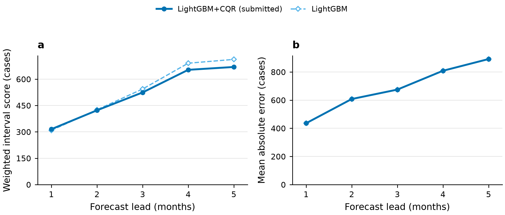
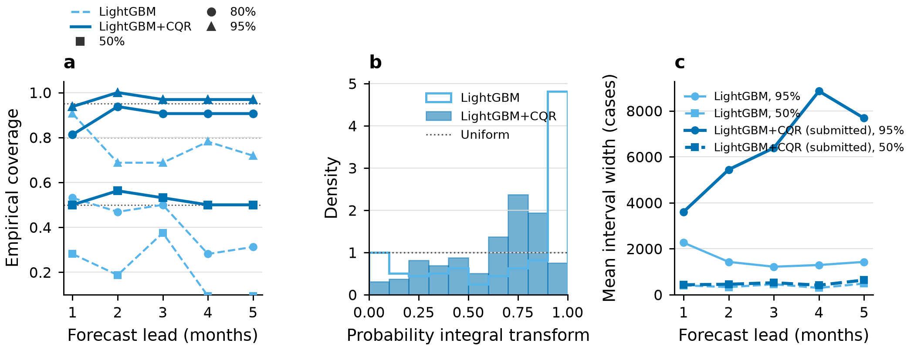
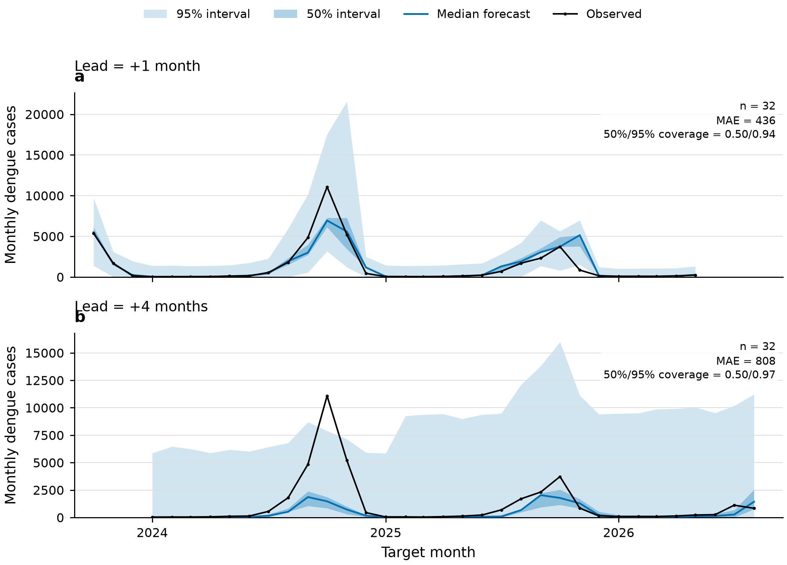
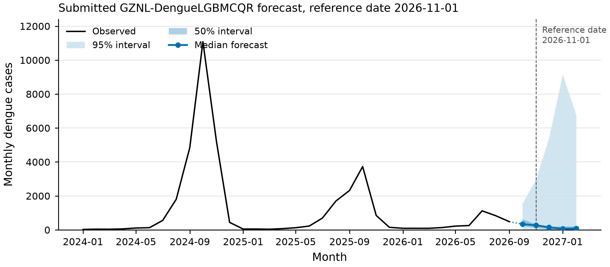
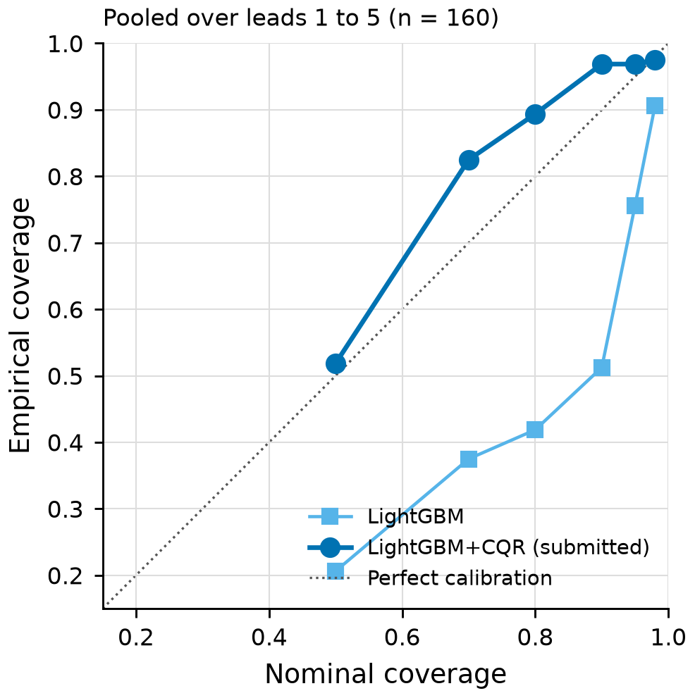

# GZNL-dengue-forecast-models

广州国家实验室（GZNL Group）的中国登革热月度发病数预测模型，面向
[China Infectious Disease Forecast Hub](https://github.com/dailypartita/China-Infectious-Disease-Forecast-Hub)
的目标 **`mo inc dengue cases`**。

方法改编自 EpiETL `modeling` 套件（`backtest.py`、`ensemble_conformal.py`、
`forecast_final.py`、`prepare_data.py`）。原套件在本地全国序列上比较了多种模型；
其 `metrics_summary_v2.csv` 以 **lightgbm_cqr**（LightGBM 分位数回归 + 滑动窗口 CQR，
并带 lag-1 气候协变量）为登革热头牌方案。本仓库提交的就是这一方案，但做了三处
枢纽化改动：病例目标只用枢纽官方月度全国序列，输出改为枢纽要求的 23 个分位数，
并按提交日历把模型步长 1–5 个月对应到 hub horizon −1…3。地点仅为 `CN`，单位是
非负整数病例数。不把 Prophet 或分位数集成放进提交模型。

本目录提交的模型是 **GZNL-DengueLGBMCQR**。`designated_model` 设为 `false`：
GZNL 在该 hub 已有两个指定模型（NextWave、VincentAvg），一队最多指定两个。
模型简称带有 `Dengue` 前缀，避免与其他病种的同名方法冲突。

该模型已注册并提交 2026-11-01 轮预测，见枢纽仓库中的
[`GZNL-DengueLGBMCQR`](https://github.com/dailypartita/China-Infectious-Disease-Forecast-Hub/tree/main/model-output/GZNL-DengueLGBMCQR)。
本仓库当前文件是在同一模型编号下、加入 lag-1 气候特征后重新训练的结果。

## 预测目标

| 字段 | 取值 |
|------|------|
| `target` | `mo inc dengue cases` |
| `location` | `CN` |
| 单位 | 全国月度报告病例数，非负整数 |
| 提交步长 | 整数 `−1` 到 `3` 个月 |
| 分位数 | hub 规定的 23 个水平（0.01 … 0.99） |
| `reference_date` | 当月 1 日；`target_end_date = reference_date + horizon 个自然月` |

Hub 登革热的 `reference_date` 是当月 1 日。以 2026-11-01 轮为例，最后一次观测是
**2026-09-01**，因此 hub horizon −1、0、1、2、3 分别对应模型 lead 1 到 5
（目标月 2026-10 至 2027-02）。日期一律用日历月偏移，绝不用周。

## 训练集

病例来自官方 hub 文件 `target-data/time-series.csv`，筛选
`target == "mo inc dengue cases"` 且 `location == "CN"`。本仓库
`data/time-series.csv` 是生成 2026-11-01 提交时使用的快照，也是回测的唯一病例目标。

该快照中，登革热序列一共有 **273 个整月观测**，时间范围是
**2004-01-01 至 2026-09-01**，中间没有缺月，全部为有限非负数值。
历史峰值出现在 2014-10（28,796 例），2024-10 为近年高峰（11,083 例）。
2026 年近期观测：01=93，02=94，03=92，04=137，05=222，06=255，07=1,120，08=836，09=486。
EpiETL 整理的全国合计与这条枢纽序列不一致（例如 2026-08 为 683 对 836），
因此只借用 EpiETL 的气候序列，不借用它的病例数。

气候按月初日期合并到病例序列上，文件是：

| 文件 | 内容 | 覆盖 | 行数 |
|------|------|------|------|
| `data/covariates_enso.csv` | NOAA ONI（`enso_oni`，海温距平，`unit=degC_anom`，`source=noaa_oni`） | 1950-01-01 至 2026-08-01，无缺月 | 920 |
| `data/covariates_era5_china.csv` | ERA5 中国月平均（`geo_name=China`，`iso3=CHN`）：`temp_mean`、`precip_mean`、`rel_humid_mean` | 2010-01-01 至 2026-09-01，无缺月 | 201 |

ERA5 只保留中国，不提交原来的 30 个国家表。数值从 EpiETL 的 parquet 原样写出，CSV 以完整的 float64 精度保存。

在起点月 `t`，四个气候特征 `enso_oni_l1`、`temp_mean_l1`、`precip_mean_l1`、`rel_humid_mean_l1` 取的是 **`t−1` 月**的协变量，也就是做预测时已经发布的值。直接多步预测的每个 lead 都使用起点 `t` 上的同一行特征，因此任何步长都不会读到 `t` 月或更晚的气候。2026-11-01 这轮的预测起点是 2026-09，对应的 lag-1 气候月是 **2026-08**（ONI 收到 2026-08 即够用）。ERA5 中国的 2026-09 已在文件中，本轮预测不使用它。

气候缺测不做插补。病例滞后从 2004-12 起就可以构成完整的病例特征，但 ERA5 中国从 2010-01 才开始，所以 2010-01 及更早的起点缺少完整的 lag-1 气候，训练时随 `dropna` 删掉。第一个完整起点是 **2010-02-01**（使用 2010-01 的 ONI 与 ERA5）。2010-02 至 2026-09 共 **200** 行特征完整。

这不是一次固定的“前 70% 训练、后 30% 测试”划分。每个预测起点都会重新拟合，并且只使用当时已经发布的观测和 `t−1` 月气候。在 2026-11-01 这次提交中，最后观测月是 2026-09，各步长只保留目标月已经观测到的训练行：

| hub horizon | 从最后观测算起的步数 k | 训练样本数 | 最后一条训练起点 |
|-------------|-------------------------|------------|------------------|
| −1 | 1 | 199 | 2026-08 |
| 0 | 2 | 198 | 2026-07 |
| 1 | 3 | 197 | 2026-06 |
| 2 | 4 | 196 | 2026-05 |
| 3 | 5 | 195 | 2026-04 |

回测第一个评估起点 2023-09 的训练样本为 163、162、161、160、159 行（lead 1 至 5），随后随历史增加到上表的 199–195 行。

## 算法原理

提交模型 **DengueLGBMCQR** 分两步：先做直接多步 LightGBM 分位数回归，再用滑动窗口
[CQR](https://arxiv.org/abs/1905.03222)（Romano, Patterson, Candès, 2019）校准区间。

**1. LightGBM 分位数回归。** 对每个预测步长、每个分位数水平单独训练一个模型
（直接多步，而不是迭代滚动一步预测）。损失函数是分位数（pinball）损失，
水平 `α` 取 hub 规定的 23 个分位数。树模型超参数为：`n_estimators=300`，
`learning_rate=0.05`，`num_leaves=15`，`min_child_samples=5`，`random_state=42`。
训练在 `log1p` 空间进行，预测后再 `expm1` 并截断到 ≥ 0。

特征在起点月 `t` 构造，不使用未来信息：

- 滞后 1、2、3、6、12 个月（`lag_k` 为最近第 k 个观测，故 `lag1 = y_t`，`lag12 = y_{t-11}`）
- 近 3 个月与近 12 个月滚动均值（`r3m`、`r12m`）
- 一阶差分（`d1 = lag1 − lag2`）
- 起点月的年周期 Fourier 项（`cal_sin1`、`cal_cos1`；用的是起点月，不是目标月）
- lag-1 气候：`enso_oni_l1`、`temp_mean_l1`、`precip_mean_l1`、`rel_humid_mean_l1`，即 `t−1` 月的 ONI 与 ERA5 中国月平均

拟合后的 23 个分位数会做保序处理（`np.maximum.accumulate`），避免分位数交叉。

**2. 保形分位数回归（CQR）。** 对每个对称分位数对 `(τ, 1−τ)`（`τ < 0.5`），用最近最多 24 个
已实现起点的预测，计算一致性得分 `S = max(q_lo − y, y − q_hi)`，再按
`ceil((n+1)(1−α))/n` 分位数（`α = 2τ`，`method="higher"`）把区间**外扩**为
`[q_lo − Q, q_hi + Q]`，下界截到 0，中位数不动。前 10 个起点只输出未经 CQR 的分位数。
CQR 之后再次保序、非负，并四舍五入为整数病例数；下侧分位数不会被重排到超过中位数。

## 如何确保模型可靠

可靠性主要靠「不泄露未来信息」的滚动起点回测，以及区间校准来约束。

- **无前瞻。** 起点月 `t` 只能看到 `target_end_date ≤ t` 的病例，以及 `t−1` 月的气候。特征、训练标签和 CQR 校准分数都在这条截断线之内。气候缺测删除，不前填、不插补。
- **滚动起点回测。** 评估窗口为月度原点 2023-09 至 2026-04（此窗口内 lead 1–5 的结局均已观测），共 32 个起点 × 5 个步长 = 160 对。滚动预测从 2021-09 开始，以便 24 个月 CQR 窗口在评估开始前预热。
- **公平比较窗口。** 指标只在评估窗口上计算。该窗口第一个起点的校准样本数为 24、23、22、21、20（lead 1 至 5），之后不超过 24，避免把尚未校准的早期点混进来。
- **对照与事先规则。** 同一套回测里同时评估未校准 LightGBM 与 LightGBM+CQR。提交方法按评估窗口上的平均加权区间分数（WIS，23 个分位数得分的平均）选择，结果是 LightGBM+CQR。
- **覆盖率检查。** 除 MAE、WIS 外，报告 50%（0.25–0.75）、90%（0.05–0.95）和 95%（0.025–0.975）区间的经验覆盖。CQR 后这三项从 0.206 / 0.512 / 0.756 变为 0.519 / 0.969 / 0.969。50% 接近名义水平，90% 与 95% 偏保守。点预测的 MAE 几乎不变（683.72 与 683.70），因为中位数不被 CQR 移动，差别只来自最终取整。
- **输出约束。** 预测值限制为非负整数病例数，并强制分位数单调，减少无效区间。
- **格式校验。** 提交前检查列名、行数、分位数集合、单调性、非负整数和日期关系；hub 仓库的 CI 会在 pull request 上运行 hubValidations。

需要注意的限制：训练使用 2010-02 以来全部特征完整的历史，没有单独剔除疫情年份；CQR 的 24 个月窗口包含 2024-10 高峰（11,083 例），会把 90% / 95% 上侧区间拉得很宽。在这 160 个点上，CQR 的 0.025 与 0.05 分位数有 97.5% 落成同一个整数，下界经常被截到 0；90% 与 95% 区间盖住的是同一批观测，经验覆盖都是 155/160。这是方法本身的结果，提交时未再人为收紧尾部。

## 回测摘要

指标在公平评估窗口上计算（32 个起点 × 5 个步长，共 160 个预测点）。WIS 为 23 个分位数得分的平均。50%、90%、95% 覆盖分别对应分位数区间 0.25–0.75、0.05–0.95、0.025–0.975，与 `analysis/backtest_metrics.csv` 的 `cov50`、`cov90`、`cov95` 一致。

| 方法 | n | MAE | WIS | 50% 覆盖 | 90% 覆盖 | 95% 覆盖 |
|------|---|-----|-----|----------|----------|----------|
| **lightgbm_cqr（提交）** | 160 | 683.72 | **516.9** | 0.519 | 0.969 | 0.969 |
| lightgbm | 160 | 683.70 | 536.2 | 0.206 | 0.512 | 0.756 |

按平均 WIS 选择 LightGBM+CQR（516.9 对 536.2）。CQR 各步长的 WIS 为 315.3、422.6、524.3、653.0、669.2；未校准 LightGBM 为 308.4、425.9、543.7、690.7、712.4。lead 1 上未校准模型的 WIS 低 6.9 分，lead 2–5 上 CQR 更好。详细分步长、分月份指标见 `analysis/backtest_metrics.csv`。

## 可靠性图示

图由 `scripts/plot_reliability.py` 根据公平回测子集（每步长 32 个起点，共 160 个预测点）和本次 2026-11-01 预测生成；`figures/` 中同时提供 PNG 和可编辑的 PDF。五张图都对应带 lag-1 气候特征的模型。

**图 1. 预测精度随步长的变化。** 平均 WIS 上 LightGBM+CQR 优于未校准 LightGBM，但 lead 1 例外：两条 WIS 曲线在第一步几乎重合，未校准模型略低。lead 2 以后 CQR 的优势变大。CQR 不移动中位数，因此 MAE 两条曲线重合，并随步长上升。



**图 2. 区间校准与锐度。** (a) 合计来看，CQR 后 50% 覆盖接近名义水平（0.519），80%（0.10–0.90）从 0.419 升到 0.894，95% 从 0.756 升到 0.969；未校准模型在各步长上都偏低。(b) 未校准 LightGBM 的概率积分变换（PIT）在 1 附近堆积，说明区间过窄；CQR 后质量离开右端，分布仍不完全均匀。(c) 代价是区间变宽：95% 平均宽度从约 1,525 例增到约 6,394 例，50% 从约 394 例增到约 491 例。



**图 3. 回测轨迹。** +1 个月预测的中位数能跟上 2024-10 与 2025 年秋季高峰（该面板 n=32，MAE=436，50%/95% 覆盖 0.50/0.94）。+4 个月对 2024-10 高峰明显偏低，95% 区间很宽（MAE=808，50%/95% 覆盖 0.50/0.97）。



**图 4. 2026-11-01 提交预测。** 在最近一次观测 486 例之后，中位数为 337、272、149、69、82（2026-10 至 2027-02）。五个步长的 90% 下界都是 0，上界为 1,543、2,891、5,428、8,964、6,754，2027-01 最宽。图中保留 2024-10 高峰，便于对照 CQR 上侧区间的宽度来源。



**图 5. 可靠性图。** 将名义覆盖与经验覆盖对照（n=160）。未校准 LightGBM 在图中各名义水平上均偏低（50% 至 98% 的经验覆盖为 0.206、0.375、0.419、0.512、0.756、0.906）。CQR 在 50% 处为 0.519，贴近对角线；70%、80%、90%、95% 为 0.825、0.894、0.969、0.969，高于名义水平；98% 为 0.975。90% 与 95% 覆盖相同，所以曲线在右端走平。



## 本次提交（reference_date = 2026-11-01）

最后一次观测是 2026-09-01，报告病例 **486**。预测起点使用的 lag-1 气候是 2026-08：ONI 为 2.16，ERA5 中国的 `temp_mean`、`precip_mean`、`rel_humid_mean` 取该月原值（完整精度见 `data/covariates_era5_china.csv`）。各步长进入 CQR 时校准样本数都是 24。中位数与 90% 区间（0.05–0.95）：

| horizon | target_end_date | 5% | 中位数 | 95% |
|---------|-----------------|----|--------|-----|
| −1 | 2026-10-01 | 0 | 337 | 1,543 |
| 0 | 2026-11-01 | 0 | 272 | 2,891 |
| 1 | 2026-12-01 | 0 | 149 | 5,428 |
| 2 | 2027-01-01 | 0 | 69 | 8,964 |
| 3 | 2027-02-01 | 0 | 82 | 6,754 |

2026-11-01 是该目标的合法轮次。按枢纽日历，提交截止为北京时间周三 23:59；本轮首次提交在周四完成，有可能按迟交处理。模型编号已从 `GZNL-LGBMCQR` 更名为 `GZNL-DengueLGBMCQR`。上表是加入 lag-1 气候特征后重新训练的数值。

## 如何运行

```bash
bash run.sh
```

`run.sh` 会在需要时创建 `.venv`、安装 `requirements.txt`，并运行：

```bash
python -m models.lgbm_cqr
```

这会读取 `data/time-series.csv`、`data/covariates_enso.csv` 和 `data/covariates_era5_china.csv`，训练并写出
`output/GZNL-DengueLGBMCQR/2026-11-01-GZNL-DengueLGBMCQR.csv`
（5 个 horizon × 23 个分位数 = 115 行数据 + 表头，UTF-8 无 BOM，8 列），
以及 `output/GZNL-DengueLGBMCQR/rolling_raw_cqr.csv`。

回测（不阻塞提交）：

```bash
source .venv/bin/activate
python -m analysis.backtest
```

默认在 2023-09 至 2026-04 的月度原点上评估，并会从 2021-09 开始滚动预测以便 CQR 窗口预热。
指标写入 `analysis/backtest_metrics.csv`，逐点预测写入 `analysis/backtest_predictions.csv`。

根据已有回测和提交文件重画本仓库中的图：

```bash
source .venv/bin/activate
python scripts/plot_reliability.py
```

本机未安装 R / hubValidations，提交前做了列名、行数、分位数集合、单调性、
非负整数和日期关系的格式检查。仓库 CI 会在 pull request 上运行 hubValidations。

## 目录

```
models/               枢纽日历、LightGBM 与 CQR（含 lag-1 气候特征）
analysis/             滚动起点回测与指标
scripts/plot_reliability.py   本仓库可靠性图
requirements.txt
run.sh                训练并写出提交 CSV 的入口
model-metadata/       模型注册 YAML 副本
output/               hubverse 预测 CSV 与滚动原始/CQR 表
data/time-series.csv  本次运行使用的官方 time-series 快照（病例目标）
data/covariates_enso.csv         NOAA ONI，1950-01 至 2026-08
data/covariates_era5_china.csv   ERA5 中国月平均，2010-01 至 2026-09
figures/              回测与提交图（PNG 与 PDF）
```
